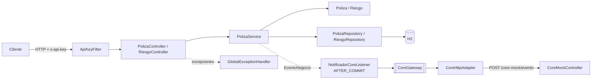

# API de gestión de pólizas

API REST para gestionar pólizas de arrendamiento y sus riesgos (inmuebles asegurados): consultar pólizas y riesgos, renovar y cancelar pólizas, y agregar o cancelar riesgos en pólizas colectivas. Cada cambio de estado se notifica a un CORE externo (simulado localmente) una vez confirmada la transacción.

Stack: Spring Boot 4.1.1, Java 21, Spring Data JPA, H2 en memoria, Bean Validation.

## Requisitos y ejecución

- JDK 21.
- No hace falta instalar Maven: el proyecto incluye el wrapper (`mvnw` / `mvnw.cmd`).

Levantar la aplicación (puerto 8080):

```bash
# Windows (PowerShell)
.\mvnw.cmd spring-boot:run

# Linux / Mac
./mvnw spring-boot:run
```

Ejecutar las pruebas:

```bash
# Windows (PowerShell)
.\mvnw.cmd test

# Linux / Mac
./mvnw test
```

Configuración (`src/main/resources/application.properties`):

| Propiedad | Valor por defecto | Uso |
|---|---|---|
| `polizas.ipc` | `5.2` | IPC (en %) aplicado al canon al renovar |
| `security.api-key` | `123456` | Valor esperado del header `x-api-key` |
| `core.url` | `http://localhost:8080/core-mock/evento` | Endpoint del CORE al que se notifican los eventos |

## Seguridad

Todas las rutas exigen el header `x-api-key` con el valor de `security.api-key` (por defecto `123456`). La única excepción es `/actuator/**`.

Si el header falta o es incorrecto, la respuesta es `401`:

```json
{"status":401,"error":"Unauthorized","mensaje":"Falta el header x-api-key"}
```

> La consola H2 (`/h2-console`) también queda detrás del filtro, por lo que no es accesible desde el navegador sin enviar el header.

## Endpoints

| Método | Ruta | Descripción | Códigos |
|---|---|---|---|
| GET | `/polizas?tipo=&estado=` | Lista pólizas. Filtros opcionales: `tipo` (`INDIVIDUAL`, `COLECTIVA`) y `estado` (`ACTIVA`, `RENOVADA`, `CANCELADA`) | 200, 400, 401 |
| GET | `/polizas/{id}` | Obtiene una póliza | 200, 400, 401, 404 |
| GET | `/polizas/{id}/riesgos` | Lista los riesgos de una póliza | 200, 400, 401, 404 |
| POST | `/polizas/{id}/renovar` | Renueva la póliza por el mismo periodo ajustando el canon por IPC | 200, 401, 404, 409 |
| POST | `/polizas/{id}/cancelar` | Cancela la póliza y todos sus riesgos | 200, 401, 404, 409 |
| POST | `/polizas/{id}/riesgos` | Agrega un riesgo. Body: `{"direccionInmueble", "arrendatario"}` (ambos obligatorios). Solo pólizas colectivas no canceladas | 201, 400, 401, 404, 409 |
| POST | `/riesgos/{id}/cancelar` | Cancela un riesgo | 200, 401, 404, 409 |
| POST | `/core-mock/evento` | Mock del CORE. Body: `{"evento", "polizaId"}`. Solo registra el evento en el log | 202, 400, 401 |

Los errores se devuelven siempre en JSON:

```json
{"timestamp":"2026-10-15T21:10:19.07Z","status":409,"error":"Conflict","mensaje":"Solo las pólizas colectivas admiten agregar riesgos"}
```

| Código | Cuándo |
|---|---|
| 400 | Body inválido (incluye `campos` con el detalle por campo), JSON mal formado, enum o id con formato inválido |
| 401 | Falta `x-api-key` o es incorrecta |
| 404 | La póliza o el riesgo no existe |
| 409 | Se viola una regla de negocio |

## Ejemplos con curl

Con la aplicación recién levantada (los ids corresponden a `data.sql`):

```bash
H="x-api-key: 123456"

# Listar todas / filtrar
curl -s http://localhost:8080/polizas -H "$H"
curl -s "http://localhost:8080/polizas?tipo=COLECTIVA&estado=ACTIVA" -H "$H"

# Obtener una póliza y sus riesgos
curl -s http://localhost:8080/polizas/3 -H "$H"
curl -s http://localhost:8080/polizas/3/riesgos -H "$H"

# Renovar la póliza 1: canon 1.500.000 -> 1.578.000; prima 18.000.000 -> 18.936.000
curl -s -X POST http://localhost:8080/polizas/1/renovar -H "$H"

# Agregar un riesgo a la colectiva 3 -> 201
curl -s -X POST http://localhost:8080/polizas/3/riesgos -H "$H" -H "Content-Type: application/json" \
  -d '{"direccionInmueble":"Calle 1 # 2-3","arrendatario":"Ana Díaz"}'

# Agregar un riesgo a la individual 1 -> 409
curl -s -X POST http://localhost:8080/polizas/1/riesgos -H "$H" -H "Content-Type: application/json" \
  -d '{"direccionInmueble":"Calle 1 # 2-3","arrendatario":"Ana Díaz"}'

# Body inválido -> 400 con detalle de campos
curl -s -X POST http://localhost:8080/polizas/3/riesgos -H "$H" -H "Content-Type: application/json" \
  -d '{"direccionInmueble":""}'

# Cancelar un riesgo activo (4) -> 200; uno ya cancelado (6) -> 409
curl -s -X POST http://localhost:8080/riesgos/4/cancelar -H "$H"
curl -s -X POST http://localhost:8080/riesgos/6/cancelar -H "$H"

# Cancelar la póliza 3 (cancela sus riesgos); repetir -> 409
curl -s -X POST http://localhost:8080/polizas/3/cancelar -H "$H"

# Renovar una póliza cancelada (4) -> 409
curl -s -X POST http://localhost:8080/polizas/4/renovar -H "$H"

# Errores: enum inválido (400), inexistente (404), sin key (401)
curl -s "http://localhost:8080/polizas?tipo=OTRA" -H "$H"
curl -s http://localhost:8080/polizas/99 -H "$H"
curl -s -i http://localhost:8080/polizas

# Mock del CORE -> 202
curl -s -i -X POST http://localhost:8080/core-mock/evento -H "$H" -H "Content-Type: application/json" \
  -d '{"evento":"PRUEBA","polizaId":1}'

# Actuator (sin key)
curl -s http://localhost:8080/actuator/health
```

**PowerShell (Windows):** usa `curl.exe` (no el alias `curl`, que es `Invoke-WebRequest`) y, en Windows PowerShell 5.1, duplica las comillas dobles dentro del JSON:

```powershell
$H = "x-api-key: 123456"
curl.exe -s http://localhost:8080/polizas -H $H
curl.exe -s -X POST http://localhost:8080/polizas/3/riesgos -H $H -H "Content-Type: application/json" -d '{""direccionInmueble"":""Calle 1 # 2-3"",""arrendatario"":""Ana Díaz""}'
```

## Datos de ejemplo

Se cargan desde `src/main/resources/data.sql` en cada arranque (la base se recrea).

**Pólizas**

| Id | Tipo | Estado | Tomador | Canon mensual | Meses | Prima | Vigencia |
|---|---|---|---|---|---|---|---|
| 1 | INDIVIDUAL | ACTIVA | Juan Pérez | 1.500.000 | 12 | 18.000.000 | 2026-01-01 → 2027-01-01 |
| 2 | INDIVIDUAL | ACTIVA | María Gómez | 2.000.000 | 6 | 12.000.000 | 2026-06-01 → 2026-12-01 |
| 3 | COLECTIVA | ACTIVA | Inmobiliaria Los Andes S.A.S. | 5.000.000 | 12 | 60.000.000 | 2026-02-01 → 2027-02-01 |
| 4 | COLECTIVA | CANCELADA | Constructora El Roble Ltda. | 3.000.000 | 12 | 36.000.000 | 2025-09-01 → 2026-09-01 |

**Riesgos**

| Id | Póliza | Dirección del inmueble | Arrendatario | Estado |
|---|---|---|---|---|
| 1 | 1 | Calle 100 # 15-20 Apto 301, Bogotá | Carlos Ramírez | ACTIVO |
| 2 | 2 | Carrera 43A # 1-50 Apto 1204, Medellín | Laura Torres | ACTIVO |
| 3 | 3 | Avenida 6N # 23-45 Local 2, Cali | Panadería La Espiga S.A.S. | ACTIVO |
| 4 | 3 | Calle 72 # 10-07 Oficina 501, Bogotá | Andrés Castillo | ACTIVO |
| 5 | 3 | Carrera 54 # 68-120 Apto 802, Barranquilla | Sofía Herrera | ACTIVO |
| 6 | 4 | Calle 50 # 80-15 Bodega 4, Medellín | Distribuidora Antioquia Ltda. | CANCELADO |
| 7 | 4 | Carrera 7 # 32-16 Apto 1001, Bogotá | Valentina Ruiz | CANCELADO |

## Reglas de negocio

Las reglas viven en el dominio (`domain/Poliza.java` y `domain/Riesgo.java`); el servicio solo orquesta. Una violación lanza `ReglaNegocioException`, que se traduce a `409`.

| Regla | Dónde |
|---|---|
| Prima = canon mensual × meses de vigencia (2 decimales, redondeo HALF_UP) | `Poliza` (constructor y `renovar`) |
| Fecha fin = fecha inicio + meses de vigencia | `Poliza` (constructor y `renovar`) |
| No se puede renovar una póliza cancelada | `Poliza.renovar` |
| Renovar ajusta el canon por IPC, recalcula la prima, mueve la vigencia al periodo siguiente y deja el estado en `RENOVADA` | `Poliza.renovar` |
| No se puede cancelar una póliza ya cancelada | `Poliza.cancelar` |
| Cancelar una póliza cancela todos sus riesgos | `Poliza.cancelar` |
| Solo las pólizas colectivas admiten agregar riesgos | `Poliza.agregarRiesgo` |
| No se pueden agregar riesgos a una póliza cancelada | `Poliza.agregarRiesgo` |
| No se puede cancelar un riesgo ya cancelado | `Riesgo.cancelar` |

## Supuestos

- El IPC es configurable en `polizas.ipc` y se expresa en porcentaje (por defecto 5.2 %).
- Estados de póliza: `ACTIVA`, `RENOVADA`, `CANCELADA`. Estados de riesgo: `ACTIVO`, `CANCELADO`.
- Prima = canon mensual × meses de vigencia.
- Renovar actúa sobre la misma póliza (no crea una nueva): mueve la vigencia al periodo siguiente (la nueva fecha de inicio es la fecha fin anterior), ajusta el canon por IPC y deja el estado en `RENOVADA`.
- Se permiten renovaciones sucesivas (una póliza `RENOVADA` puede volver a renovarse).
- Se permite cancelar el riesgo de una póliza individual.
- "Eliminar riesgo" se interpreta como cancelación lógica: el riesgo pasa a `CANCELADO` y se conserva.
- Base de datos H2 en memoria con `ddl-auto=create-drop`: los datos se reinician en cada arranque.

## Arquitectura

Capas:

- **controller**: endpoints REST. Reciben y devuelven DTOs; nunca exponen entidades.
- **service**: `PolizaService` orquesta casos de uso con `@Transactional` y publica eventos de negocio.
- **repository**: Spring Data JPA (`PolizaRepository` con filtro opcional por tipo y estado, `RiesgoRepository`).
- **domain**: entidades `Poliza` y `Riesgo` con las reglas de negocio.
- **dto**: records de entrada y salida.

Integración con el CORE (hexagonal): el puerto `port/CoreGateway` define `notificarEvento(evento, polizaId)` y el adapter `adapter/CoreHttpAdapter` lo implementa con `RestClient` (POST a `core.url` con `x-api-key`). Si el CORE falla, registra un WARN y no interrumpe la operación.

Eventos: el servicio publica un `EventoNegocio` (`RENOVACION`, `CANCELACION`, `RIESGO_AGREGADO`, `RIESGO_CANCELADO`). `NotificadorCoreListener` lo recibe con `@TransactionalEventListener(phase = AFTER_COMMIT)`, de modo que el CORE solo se notifica si la transacción confirma.

Transversales: `security/ApiKeyFilter` (filtro `x-api-key`) y `exception/GlobalExceptionHandler` (`@RestControllerAdvice` que traduce excepciones a JSON).



## Mejoras para producción

- **Entrega confiable al CORE**: patrón Outbox (evento persistido en la misma transacción) con un publicador con reintentos y backoff exponencial, y circuit breaker (p. ej. Resilience4j) hacia el servicio agnóstico desplegado en WebLogic.
- **Base de datos real** (p. ej. Oracle o PostgreSQL) con migraciones versionadas con Flyway en lugar de `create-drop`.
- **Autenticación robusta**: JWT / OAuth2 con Spring Security en lugar de una api-key fija.
- **Paginación** en los listados de pólizas y riesgos.
- **Observabilidad**: métricas (Micrometer/Prometheus) y trazas distribuidas (OpenTelemetry) con correlación hacia el CORE.
